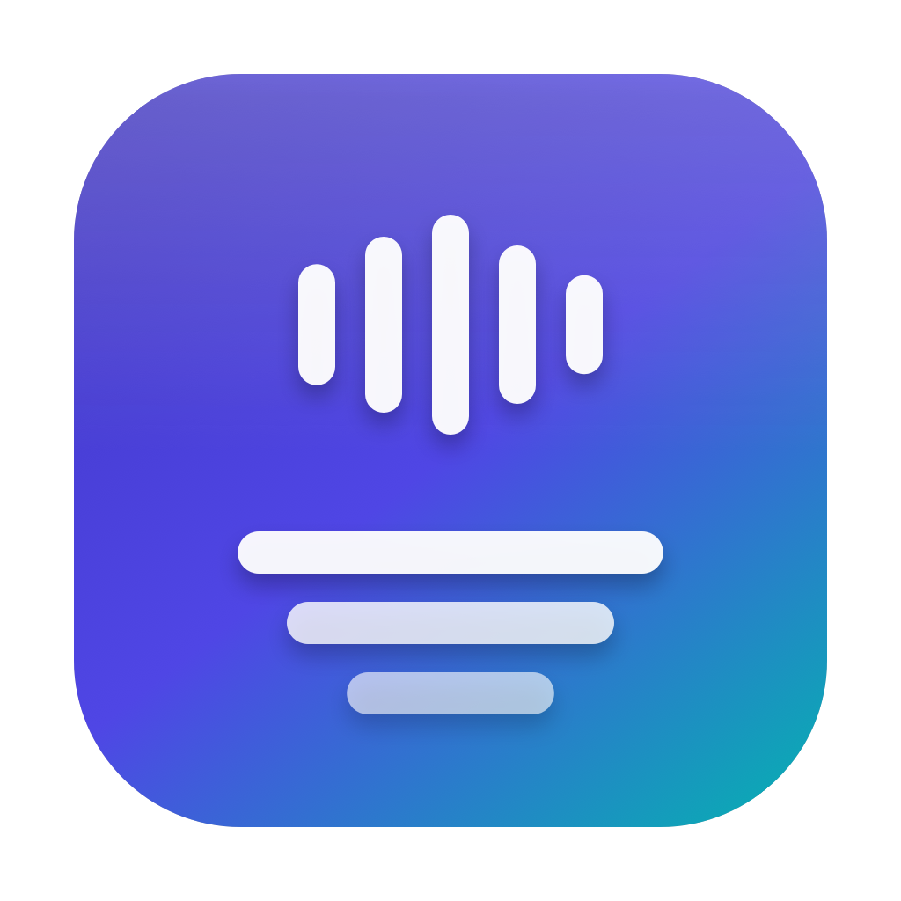

<div align="center">
  
  <h1>scrib3</h1>
  <p><b>A native macOS transcriber that turns video and audio into subtitle files, entirely on your Mac.</b></p>

  <p>
    <a href="https://github.com/onurergut/scrib3/actions/workflows/ci.yml"></a>
    <a href="https://github.com/onurergut/scrib3/releases/latest"></a>
    
    
  </p>
</div>

---

**Status:** actively developed. Latest release: **0.1.0** (30 October 2026).

scrib3 turns a video or audio file into an **SRT**, **VTT**, or plain **TXT**
subtitle file. Drag files in, choose a language, and review the transcript next
to a player before exporting. Speech recognition runs on-device; your media is
never uploaded.

## Why scrib3

- **macOS dictation** can type what it hears, but it does not produce subtitle
  files, respect subtitle line and duration rules, or let you review timed cues
  beside the video.
- **Online transcription services** are convenient, but they upload your
  recordings and usually charge per minute. scrib3 reads the file where it is.
- **Command-line Whisper setups** are excellent and scriptable. scrib3 is for
  interactive work: drag, transcribe, click a cue to hear it, fix the text,
  export.
- **Other subtitle editors** assume you already have a transcript. scrib3 does
  the transcription and the subtitle shaping in one native SwiftUI app.

**When not to use scrib3:** you need speaker labels (diarization), subtitles
burned into the video, translation, or live microphone transcription. It is not
a forensic tool: noisy rooms, heavy music, crosstalk, and strong accents reduce
accuracy, and every transcript should be reviewed before publishing. It also
needs network access the first time a language model is downloaded, and it
requires macOS 26 or later.

## Install

1. Open the [releases page](https://github.com/onurergut/scrib3/releases) and
   download the build for your Mac:
   - **Apple Silicon** → `scrib3-0.1.0-apple-silicon.zip`
   - **Intel** → `scrib3-0.1.0-intel.zip`
2. Unzip in Finder and drag **scrib3** to Applications.
3. Open it. Public releases are Developer ID-signed and notarized by Apple.

**Requirements:** macOS 26 or later. No Homebrew, account, or runtime download
is needed to launch the app.

## Use

1. Drop video or audio files onto the window, or press **Add Files…**
   (⌘O). MP4, MOV, M4A, MP3, WAV, and other formats AVFoundation can read are
   accepted.
2. Choose a **language** and an **engine**.
3. Transcription runs through a queue. Progress is shown per file; **Cancel**
   stops the queue, and **Retry failed** re-runs only the failures.
4. Click a finished file to open the review pane. The player and the cue list
   share a timeline; click a timestamp to jump there. Cue text is editable in
   place.
5. **Export** writes SRT, VTT, or TXT for the selected file. **Export all**
   writes one file per finished item into a folder you choose.

**Finder:** right-click selected video or audio files →
**Quick Actions → Transcribe with scrib3**. The Quick Action appears after the
app has been launched once.

## Subtitles

scrib3 does not dump raw recognizer output into a file. Cues are built with
standard subtitle limits:

- at most **2 lines** per cue and about **42 characters** per line,
- at most **7 seconds** per cue,
- breaks at sentence punctuation or pauses, never inside a word,
- a readable minimum duration, without overlapping the next cue.

The exact rules and edge cases are in
[`docs/SUBTITLE_RULES.md`](docs/SUBTITLE_RULES.md). Wrapping is applied on
export, so edited text is re-wrapped with the same rules.

## Engines

scrib3 ships with two transcription backends behind one protocol.

| Engine | Model | Download | Best for |
|---|---|---|---|
| **Apple Speech** (default) | `SpeechTranscriber` where Apple supports the locale; `DictationTranscriber` fallback elsewhere, including Turkish | Managed by macOS, downloaded once | Long-form audio, 45+ locales, zero third-party dependency |
| **WhisperKit** | OpenAI Whisper large-v3, Core ML | 626 MB once from Hugging Face | Turkish punctuation and capitalization, 99 languages, higher accuracy |

**Honest model download:** Apple's speech assets are downloaded by macOS the
first time a language is used, then shared between apps and retained by the
system. WhisperKit's model is downloaded from Hugging Face the first time that
engine is selected and cached in Application Support. After that, transcription
is fully offline. Neither engine uploads your audio; the downloads fetch model
files only.

The Apple engine prefers `SpeechTranscriber`, which supports 45 locales on the
tested macOS release and produces punctuation. It deliberately does **not**
support Turkish, so Turkish falls back to `DictationTranscriber`. That fallback
transcribes accurately but returns unpunctuated, lowercase text in roughly
60-second chunks. WhisperKit is the better choice when punctuation and casing
matter for Turkish subtitles.

Language lists come from the frameworks at runtime, not from a hard-coded
table. Details and the engine protocol are in [`docs/ENGINES.md`](docs/ENGINES.md).

## Privacy

Video and audio files are read on this Mac and never uploaded. There is no
telemetry, analytics, crash reporting, account, or system-profile upload.

Network access is used only for one-time model downloads:

- **Apple Speech:** macOS fetches the language asset from Apple's servers.
- **WhisperKit:** the model is fetched from Hugging Face
  (`huggingface.co`, `cdn-lfs.huggingface.co`).

Those services see ordinary connection metadata such as your IP address,
which is unavoidable for a download.

## Known limitations

- **No diarization.** scrib3 does not label speakers.
- **No burn-in, translation, or live microphone input.**
- **Accuracy is not guaranteed.** Background noise, music, overlapping speech,
  and unusual accents degrade results. Review before publishing.
- **Apple's Turkish fallback has no punctuation or capitalization** and chunks
  results at about 60 seconds. WhisperKit is the recommended engine for Turkish.
- **WhisperKit loads the audio track into memory** for full-file transcription.
  Very long recordings need corresponding free memory.
- **First use needs network access** for the selected engine's model.
- **Intel Macs** can run scrib3 on macOS 26, but `SpeechTranscriber`
  availability depends on the hardware; the Dictation fallback covers more
  devices.
- **Editing:** explicit line breaks are not preserved; export re-wraps text with
  the subtitle rules. A single word longer than the line limit is kept intact.

The longer list is in [`docs/LIMITATIONS.md`](docs/LIMITATIONS.md).

## Demo

<!-- docs/demo.gif is the recorded demo slot; keep this block until the GIF is recorded. -->
A short demo GIF will live at `docs/demo.gif`.

## Documentation

- [Engine behavior and model download](docs/ENGINES.md)
- [Subtitle rules](docs/SUBTITLE_RULES.md)
- [Known limitations](docs/LIMITATIONS.md)
- [Changelog](CHANGELOG.md)

## Build from source

Requires Xcode 26 or later (macOS 26 SDK) and the Xcode command line tools.

```sh
swift test                 # unit tests
swift run scrib3           # run the app
```

Integration tests use the real Speech framework and may download language
assets:

```sh
SCRIB3_INTEGRATION=1 swift test --filter AppleSpeechIntegration
SCRIB3_WHISPER_INTEGRATION=1 SCRIB3_WHISPER_MODEL=openai_whisper-tiny \
  swift test --filter WhisperKitIntegration
```

Packaging, signing, notarization, and release builds are described in
[CONTRIBUTING.md](CONTRIBUTING.md#release-builds).

## Contributing

Bug reports and pull requests are welcome. Read
[CONTRIBUTING.md](CONTRIBUTING.md) first. The project follows the same rules as
its sibling [conv3rt](https://github.com/onurergut/conv3rt): never claim an
unverified capability, keep the core UI-free and tested, and keep the app small.

## License

MIT for scrib3's own code. WhisperKit is MIT; swift-argument-parser is Apache
2.0 with the Runtime Library Exception. The Whisper model is downloaded at
runtime and is not part of this repository or the app bundle. See
[`THIRD_PARTY_NOTICES.txt`](THIRD_PARTY_NOTICES.txt).
